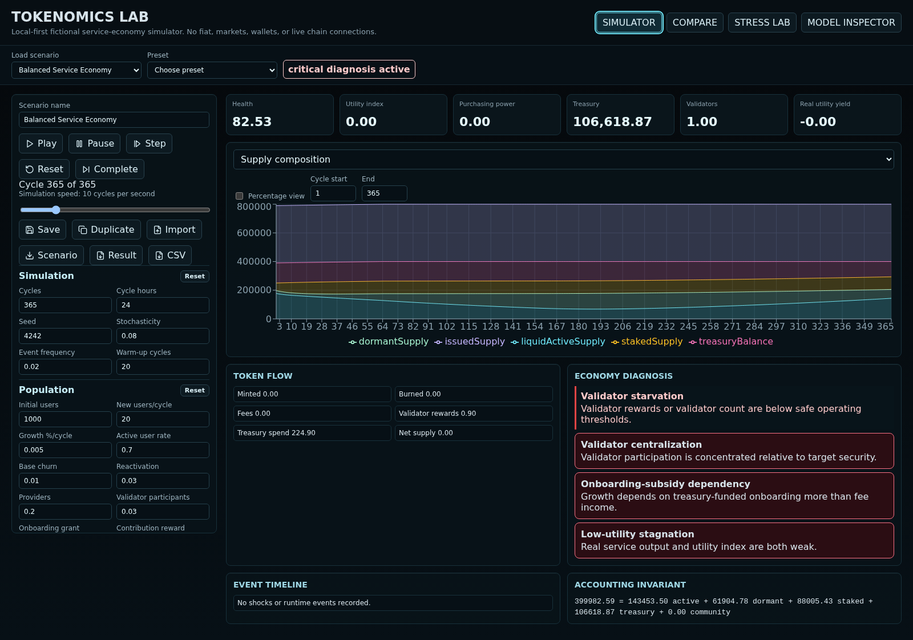
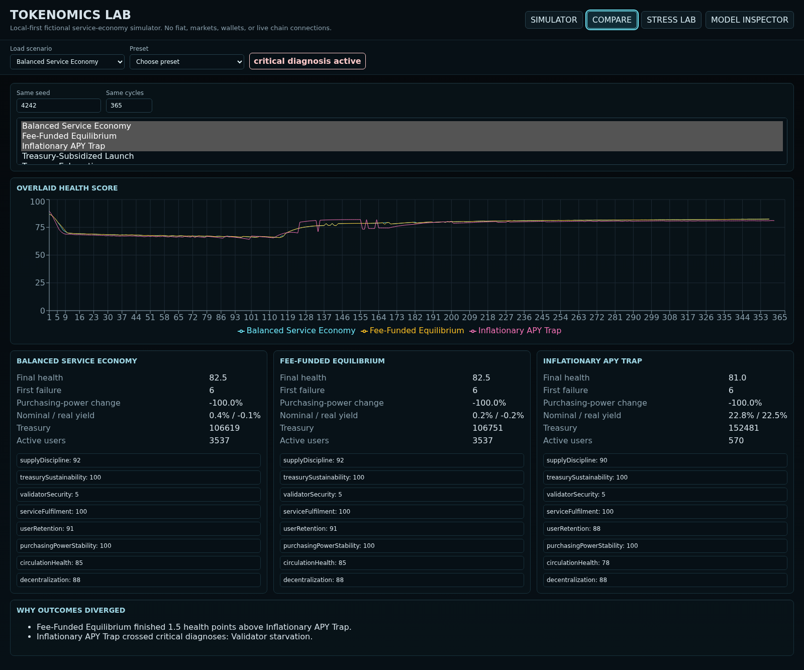
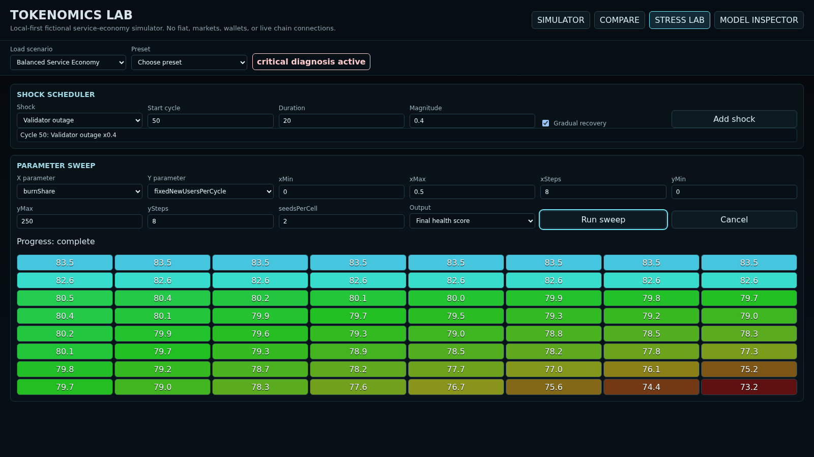

# Tokenomics Lab

[](https://github.com/TheOmegaFett/Tokenomics/actions/workflows/pages.yml)
[](LICENSE)
[](package.json)
[](package.json)
[](package.json)

**Design, simulate, and stress-test fictional token economies in your browser.** Tokenomics Lab is a local-first sandbox for exploring how issuance, fees, staking, treasury spending, service demand, and validator incentives interact. It uses no wallet, exchange, live chain, or market data.

[**Open the live demo**](https://theomegafett.github.io/Tokenomics/) · [**Browse the source**](https://github.com/TheOmegaFett/Tokenomics)



## Explore the workspaces

| Workspace | What you can do |
| --- | --- |
| **Simulator** | Edit parameters, play or step through cycles, inspect charts and diagnoses, and export scenarios or results. |
| **Compare** | Run up to three scenarios with the same seed and cycle count to see how outcomes diverge. |
| **Stress Lab** | Schedule shocks and run seeded parameter sweeps in a Web Worker. |
| **Model Inspector** | Review parameters, formulas, and health-score components. |

| Compare scenarios | Stress-test a parameter sweep |
| --- | --- |
|  |  |

Twelve presets include balanced, fee-funded, inflationary, treasury-depletion, validator-starvation, and congestion scenarios. Scenarios saved in the app stay in your browser's local storage. You can also import or export scenario JSON, export result JSON, and download cycle metrics as CSV.

## Get started

Use Node.js 22.12 or newer. From the repository root:

```sh
npm ci
npm run dev
```

Open the local URL printed by Vite. Choose a preset or edit parameters. **Play** advances over time; **Pause**, **Step**, **Reset**, and **Complete** control the run. The speed slider sets the target playback rate in cycles per second. After a complete run, Play or Step starts again at cycle one.

| Command | Purpose |
| --- | --- |
| `npm test` | Run the deterministic simulation-engine tests. |
| `npm run test:e2e` | Run browser tests; Playwright starts its own dev server. |
| `npm audit --audit-level=high` | Check dependencies against published advisories. |
| `npm run build` | Type-check and build the static site in `dist/`. |
| `npm run preview` | Preview the production build locally. |
| `npm run screenshots` | Refresh README screenshots against a running dev server. |

If Chromium is missing, install it with `npx playwright install chromium` before running browser tests or capturing screenshots.

## Model at a glance

The simulator models a closed, fictional service economy. Aggregate users hold, spend, stake, become dormant, leave, and re-enter. Providers complete abstract service units. Validators respond to rewards, costs, confidence, and slashing risk. Treasury is a token reserve, not fiat.

Every cycle checks the accounting identities:

```text
issuedSupply = liquidActive + liquidDormant + staked + treasury + communityRewardPool
endingIssuedSupply = startingIssuedSupply + mintedThisCycle - burnedThisCycle
```

Utility Purchasing Power is service units purchasable per token (`1 / averageServicePrice`). The Utility Value Index combines purchasing power, service availability, quality, reliability, validator coverage, confidence, liquidity, and volatility. Nominal staking yield is token-denominated; real utility yield adjusts it for purchasing-power change. See [`src/simulation/`](src/simulation/) for the pure TypeScript engine, presets, shocks, diagnostics, invariants, metrics, and sweeps.

## Deploy to GitHub Pages

The [GitHub Actions workflow](.github/workflows/pages.yml) runs unit and browser tests, builds the app, and deploys successful pushes to `Main` or `main`. Pull requests run the same checks without deploying. The workflow sets Vite's asset base path from the repository name, so project Pages URLs work without a hard-coded path.

1. Push this repository to GitHub.
2. In **Settings → Pages → Build and deployment**, set **Source** to **GitHub Actions**.
3. Open the [Actions tab](https://github.com/TheOmegaFett/Tokenomics/actions) to watch the first deployment. The site will be at [the live demo URL](https://theomegafett.github.io/Tokenomics/).

No API keys or external services are needed at runtime. To refresh screenshots, start `npm run dev` in one terminal and run `npm run screenshots` in another; commit the resulting files under `docs/screenshots/`.

## Scope and license

This is an educational model, not a financial application or a forecast. Participants are aggregate cohorts, and token value represents internal service utility only. Results depend on the model's assumptions and should not be treated as investment guidance.

Licensed under the [MIT License](LICENSE).
